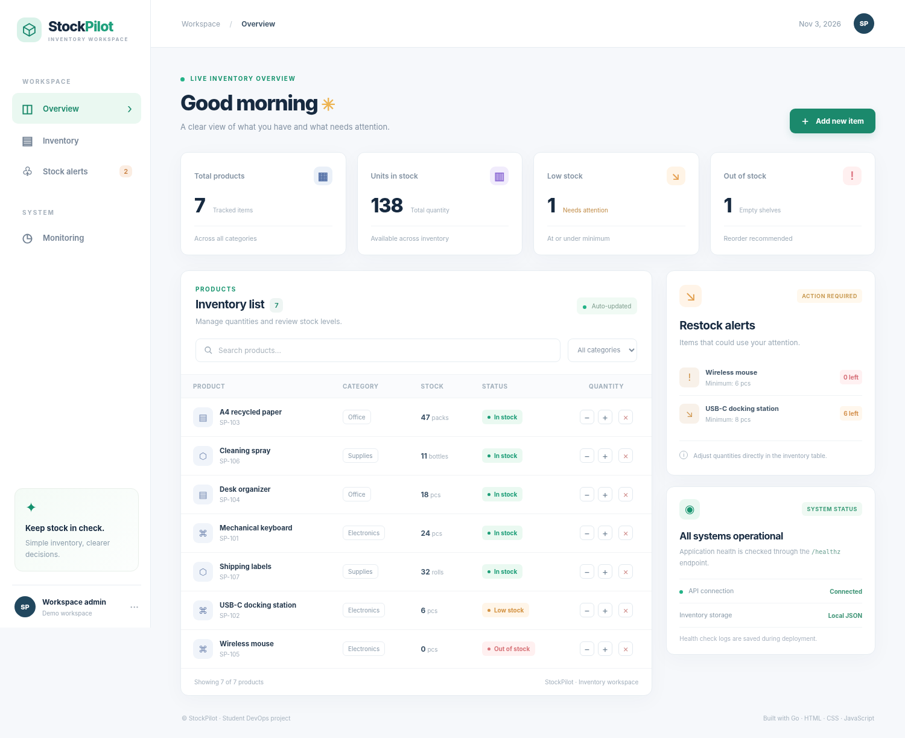
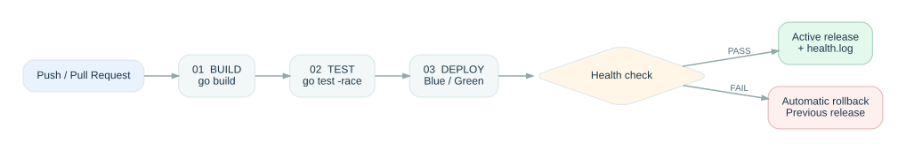
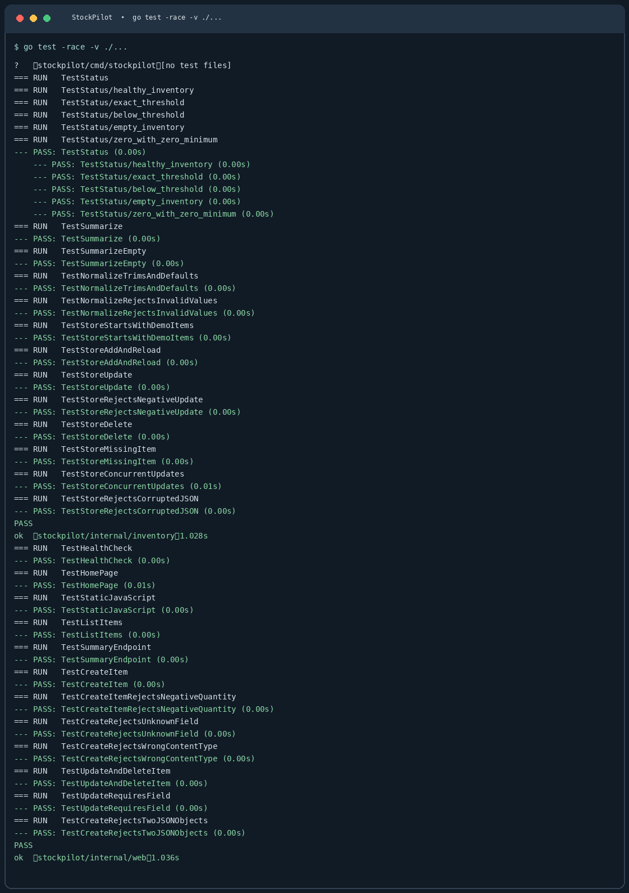
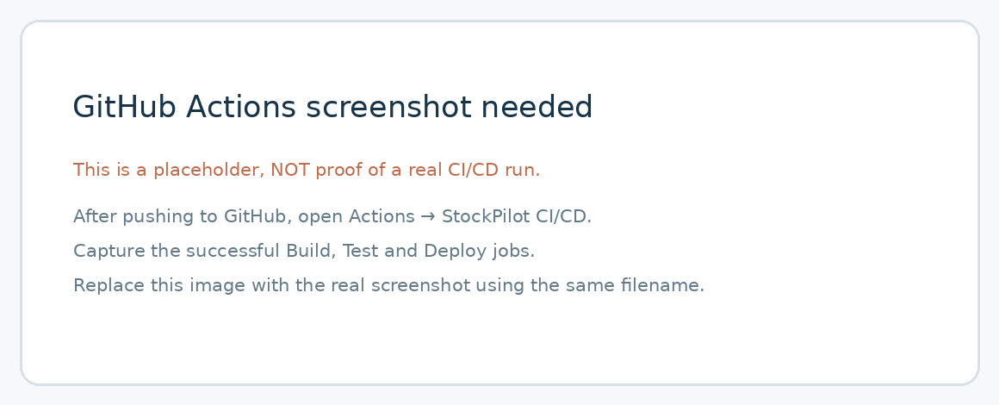

# StockPilot — Inventory Dashboard & DevOps Pipeline

StockPilot არის მცირე საწყობის მარაგების სამართავი ვებაპლიკაცია. პროექტის მთავარი მიზანია ფუნქციური აპლიკაციისთვის სრულყოფილი **Build → Test → Deploy** ავტომატიზაციის აწყობა GitHub Actions-ში, Health Check-ითა და Rollback მექანიზმით.

**ტექნოლოგიები:** Go 1.22+ (backend და ტესტები), HTML/CSS/JavaScript (frontend), JSON ფაილი (მონაცემების შენახვა), Bash (დეპლოიმენტი და მონიტორინგი), Git/GitHub Actions (CI/CD). მესამე მხარის Go ბიბლიოთეკები არ არის საჭირო.

## რას აკეთებს აპლიკაცია?

- მარაგში ახალი პროდუქტის დამატება და წაშლა;
- პროდუქტის რაოდენობის გაზრდა / შემცირება;
- ძებნა და კატეგორიების მიხედვით გაფილტვრა;
- მარაგის მდგომარეობის ავტომატური განსაზღვრა: **In stock**, **Low stock**, **Out of stock**;
- სტატისტიკის ჩვენება და დაბალი მარაგის გაფრთხილებები;
- JSON ფაილში მონაცემების შენახვა: რესტარტის შემდეგ ცვლილებები რჩება.

**მარაგის წესი:** თუ `quantity == 0`, პროდუქტი არის `Out of stock`; თუ `0 < quantity <= min_stock` — `Low stock`; სხვა შემთხვევაში — `In stock`.

### სამუშაო აპლიკაცია



*სურათზე ჩანს აპლიკაციის სამუშაო გვერდი, შვიდი სატესტო პროდუქტი, მარაგის სტატისტიკა და გაფრთხილებების პანელი. სქრინშოტი გადაღებულია რეალურად გაშვებული ლოკალური აპლიკაციის მონაცემებით.*

[მობილური ხედის სქრინშოტი](docs/screenshots/mobile-preview.png)

## პროექტის გაშვება

საჭიროა [Go](https://go.dev/dl/) **1.22 ან უფრო ახალი ვერსია**.

```bash
# 1. აპლიკაციის გაშვება
 go run ./cmd/stockpilot
```

ბრაუზერში გახსენით: **http://127.0.0.1:8080**

პირველი გაშვებისას შეიქმნება `data/items.json` შვიდი სატესტო პროდუქტით; შემდეგი გაშვებისას ფაილიდან ჩაიტვირთება უკვე შენახული მონაცემები.

```bash
# 2. ტესტების გაშვება
 go test -race -v ./...

# 3. კომპილაცია (Build)
 mkdir -p dist
 go build -o dist/stockpilot ./cmd/stockpilot

# 4. დამოუკიდებლად აგებული ბინარის გაშვება
 ./dist/stockpilot
```

Windows-ზე მესამე და მეოთხე ბრძანებებისთვის შეიძლება გამოიყენოთ `dist/stockpilot.exe` და `./dist/stockpilot.exe`. **Deploy-ის Bash სკრიპტისთვის საჭიროა Linux ან WSL.**

## Git და ბრენჩები

რეპოზიტორიაში არის ორი ძირითადი ბრენჩი: `main` და `dev`. კოდი ვითარდება `dev` ბრენჩზე, ტესტირების შემდეგ კი უერთდება `main`-ს. Commit შეტყობინებები აღწერს ცვლილებას (`feat`, `test`, `ci`, `docs`).

## CI/CD Pipeline — 3 ძირითადი Job

კონფიგურაციის ფაილი: [`.github/workflows/pipeline.yml`](.github/workflows/pipeline.yml).

| Job | რას აკეთებს | დამოკიდებულება |
| --- | --- | --- |
| **Build** | აყენებს Go გარემოს; `go build` ბრძანებით აგებს შესრულებად ფაილს და ატვირთავს GitHub Artifact-ს. | პირველი Job |
| **Test** | `go test -race -v ./...` ბრძანებით ამოწმებს მარაგის წესებს, მონაცემთა შენახვასა და HTTP API-ს. ტესტის ლოგი ინახება Artifact-ში. | მხოლოდ წარმატებული Build-ის შემდეგ |
| **Deploy** | იღებს აგებულ ფაილს, ატარებს Blue–Green Deploy-ს, Health Check-ს, საჭიროებისას Rollback-ს და ტვირთავს ლოგებს. | მხოლოდ წარმატებული Build და Test-ის შემდეგ |

Pipeline ავტომატურად ეშვება **ყოველ `push`-ზე** და **Pull Request-ზე**; ასევე ხელით `workflow_dispatch`-ით. თუ ტესტები ვერ გაივლის, Deploy აღარ შესრულდება.

### Workflow Diagram



*წყაროს შეცვლა შესაძლებელია `docs/workflow.dot` ან `docs/workflow.mmd` ფაილებით.*

## ტესტირება

Unit Test და API Test ფაილები:

- `internal/inventory/item_test.go` — სტატუსები, ჯამური სტატისტიკა და ვალიდაცია;
- `internal/inventory/store_test.go` — დამატება, ცვლილება, წაშლა, შენახვა/ხელახალი წაკითხვა, კონკურენტული განახლებები;
- `internal/web/handler_test.go` — გვერდი, Health Check და HTTP API მოთხოვნები.

ლოკალურად წარმატებით შესრულდა **25 დასახელებული ტესტი + 5 ქვეკეისი**, შეცდომების გარეშე, `-race` შემოწმებით.



*სქრინშოტში მოცემულია ლოკალურად შესრულებული `go test -race -v ./...` ბრძანების შედეგი.*

## Deploy: Blue–Green + Rollback

`scripts/deploy_local.sh` ინახავს ორ ვერსიას:

```text
production/
├── releases/
│   ├── blue/stockpilot
│   └── green/stockpilot
├── shared/items.json       # საერთო მონაცემები; ვერსიის ცვლილებაზე არ იშლება
├── current -> releases/blue ან releases/green
├── app.pid
└── logs/
    ├── deploy.log
    ├── server.log
    ├── staging.log
    └── health.log
```

Deployment-ის მიმდევრობა: (1) ახალი ფაილის კოპირება არააქტიურ `blue` ან `green` საქაღალდეში; (2) კანდიდატის გაშვება ცალკე პორტზე და Health Check; (3) მომუშავე ვერსიის გადართვა `current` სიმბოლური ბმულით; (4) სამუშაო პორტის საბოლოო Health Check; (5) შეცდომის შემთხვევაში წინა ვერსიის აღდგენა. საერთო JSON ფაილი ორივე ვერსიისთვის უცვლელი რჩება.

**ლოკალური ტესტი (Linux/WSL):**

```bash
mkdir -p dist
CGO_ENABLED=0 go build -o dist/stockpilot ./cmd/stockpilot

# პირველი გაშვება — blue
bash scripts/deploy_local.sh dist/stockpilot ./production 8080 18080

# მეორე გაშვება — green
bash scripts/deploy_local.sh dist/stockpilot ./production 8080 18080

# Health Check + log
bash scripts/monitor.sh http://127.0.0.1:8080 ./production/logs/health.log
```

Rollback ავტომატურია: თუ კანდიდატი ვერ გაივლის შემოწმებას, აქტიური ვერსია უცვლელი დარჩება; თუ გადართვის შემდეგ შემოწმება ჩავარდა, აღდგება წინა ვერსიის ბმული და პროცესი.

### მნიშვნელოვანი განსხვავება: GitHub-hosted და self-hosted runner

GitHub Actions-ის **ნაგულისხმევი `ubuntu-latest` runner დროებითია**: მასზე Build, Test, Deploy და Health Check მოწმდება, მაგრამ runner-ის დასრულების შემდეგ ლოკალური ვებაპლიკაცია მუდმივად ონლაინ აღარ რჩება. ეს არის CI/CD-ის შემოწმებადი დემონსტრაცია და არა საჯარო 24/7 ჰოსტინგი.

თუ გჭირდებათ **მუდმივი ლოკალური production**:

1. Linux/WSL კომპიუტერზე დააყენეთ GitHub-ის self-hosted runner: რეპოზიტორია → **Settings → Actions → Runners → New self-hosted runner**. აირჩიეთ Linux, მიჰყევით GitHub-ის მითითებებს და გაუშვით runner.
2. რეპოზიტორიაში გახსენით **Settings → Secrets and variables → Actions → Variables** და დაამატეთ `DEPLOY_RUNNER` მნიშვნელობით `self-hosted`.
3. სურვილისამებრ მიუთითეთ `STOCKPILOT_DEPLOY_DIR` (მაგ. `/home/runner/stockpilot-production`) და უზრუნველყავით ჩაწერის უფლებები.
4. `main`-ზე Push ისევ გაუშვებს სამივე Job-ს; Deploy ამჯერად შენს კომპიუტერში შეინახება და გამართული სერვერი იმუშავებს პორტზე `8087`.

უსაფრთხოებისთვის აპლიკაცია ნაგულისხმევად მხოლოდ `127.0.0.1` მისამართზე უსმენს. საჯარო ინტერნეტიდან გახსნას სჭირდება ცალკე სერვერი / reverse proxy და შესაბამისი ქსელური კონფიგურაცია.

## Monitoring და Health Check

`GET /healthz` აბრუნებს:

```json
{"service":"stockpilot","status":"ok"}
```

`monitor.sh` ამოწმებს HTTP პასუხს და წერს სტატუსს ლოგში (`status=UP` ან `status=DOWN`). უარყოფითი პასუხისას აბრუნებს არანულოვან exit code-ს, რაც CI/CD Job-ს წარუმატებლად მონიშნავს.

```bash
bash scripts/monitor.sh http://127.0.0.1:8080 ./production/logs/health.log
cat ./production/logs/health.log
```

### GitHub Actions-ის წარმატებული Pipeline-ის სქრინშოტი



**ყურადღება:** ეს ფაილი ახლა მხოლოდ მკაფიოდ მონიშნული **placeholder**-ია და არ წარმოადგენს რეალური GitHub Actions-ის შესრულების მტკიცებულებას. ჩაბარებამდე აუცილებელია მისი შეცვლა:

1. GitHub-ზე ატვირთეთ პროექტი ორივე ბრენჩით (`main` და `dev`).
2. გახსენით **Actions → StockPilot CI/CD → წარმატებული Workflow run**.
3. გადაიღეთ სკრინშოტი, რომელზეც ერთად ჩანს **Build**, **Test**, **Deploy** მწვანე სტატუსით.
4. რეალური სურათი შეინახეთ `docs/screenshots/actions-success.png` სახელით და გააკეთეთ commit/push.

## GitHub-ზე ატვირთვა

შექმენით **ცარიელი საჯარო** რეპოზიტორია, სახელად `StockPilot-DevOps` (არ დაამატოთ GitHub-იდან README ან .gitignore — ორივე უკვე არსებობს). გახსენით ZIP-იდან გაშლილი პროექტი ტერმინალში:

```bash
# USERNAME ჩაანაცვლეთ სტუდენტის GitHub მომხმარებლის სახელით
git remote add origin https://github.com/USERNAME/StockPilot-DevOps.git
git push -u origin main
git push -u origin dev
```

**ფინალური ჩაბარება:** მხოლოდ საჯარო GitHub რეპოზიტორიის ბმული, README-ში რეალური GitHub Actions-ის, ტესტებისა და მუშაობის სქრინშოტებით.
